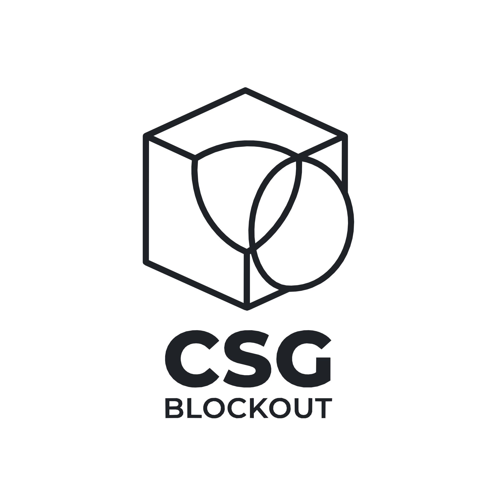

<div align="center">
  <picture>
    <source media="(prefers-color-scheme: dark)" srcset="res/icon_transparent.svg" />
    
  </picture>
  <h1>CSG_Blockout</h1>

  <p>
    <a href="README.md"></a>
    <a href="README_CN.md"></a>
    <a href="TUTORIAL_CN.md"></a>
    <a href="ARCHITECTURE_CN.md"></a>
  </p>

  <p>
    <a href="https://godotengine.org"></a>
    <a href="https://store.godotengine.org/asset/qwqzhanqwq/csg-blockout/"></a>
    <a href="LICENSE"></a>
  </p>

  <p>
    <strong>做关卡原型，不是做建模。</strong><br />
    在 Godot 4.6+ 里用原生 CSG 节点搭白盒：在视口里画出房间，对照角色尺寸检查，直接试玩，再冻结成网格，而且随时能变回 CSG。
  </p>

  
</div>

---

## 为什么是 CSG？

笔刷式关卡编辑器把几何体存在自己的数据格式里。CSG_Blockout 不这样做：你搭的每一块都是场景树里普通的 Godot CSG 节点，全程非破坏性编辑。墙随时能挪，门洞随时能改，挖掉的部分随时能删，不会有什么东西在背后被悄悄塌缩成网格。

房间定稿后可以**冻结**：它变成带碰撞的普通 `MeshInstance3D`，加载和运行都和普通网格一样，原来的 CSG 则保存在节点里。**解冻**会把那份 CSG 原样还回来，所以"烘焙了"不再等于"定死了"。

这也意味着你随时可以不用这个插件：

- **基础图元**就是原生的 `CSGBox3D`、`CSGCylinder3D` 等节点，禁用或删除插件都不受影响。
- **冻结的白盒**是普通的 `MeshInstance3D` + `StaticBody3D`，只有解冻需要插件。
- **楼梯、楔形、拱门和弧形墙**会退化为形状不变的原生 `CSGPolygon3D`；**螺旋楼梯**退化为 `CSGMesh3D`，网格随场景一起保存。
- **Repeater / Spreader** 的实例是实时预览，先点一下 **烘焙 (Bake)** 就会变成普通场景节点。
- **网格材质**存放在插件目录里：只禁用插件不受影响，删除插件目录则会丢失。

---

## 安装

### 方式一：Godot 资产库（推荐）
1. 在 Godot（4.6 及以上）编辑器顶部点击 **AssetLib (资产库)** 选项卡。
2. 搜索 `CSG Blockout`，下载并安装到你的项目中。
3. 也可以在网页上直接查看：[Godot 资产库 - CSG_Blockout](https://store.godotengine.org/asset/qwqzhanqwq/csg-blockout/)。

### 方式二：GitHub Releases (.zip)
1. 从 [Releases 页面](https://github.com/qwqzhanqwq/Godot-CSG-Blockout/releases) 下载最新版 `.zip` 压缩包。
2. 解压后将 `addons/csg_blockout` 文件夹复制到你项目的 `addons/` 目录下。

### 方式三：Git 克隆
直接克隆到项目的 `addons/` 目录：
```bash
git clone https://github.com/qwqzhanqwq/Godot-CSG-Blockout.git addons/csg_blockout
```

### 启用插件
在 Godot 中打开 **项目 -> 项目设置 -> 插件**，找到 **CSG_Blockout**，勾选 **启用**。

---

## 快速上手

1. **画一个房间**：点视口左侧工具面板里的 **房间**（或按 `Shift + A` 从饼菜单里选），在地面上拖出地板轮廓，松开鼠标房间就建好了。
2. **挖门洞**：点 **门**，再点一下墙。洞口会对齐墙面、贯穿整个墙厚并落到地面。
3. **调整形状**：拖动选中形状各个面上的箭头来推拉，或者点尺寸标注直接输入数值。方向键按一个栅格步长微调，`[` / `]` 切换栅格尺寸。
4. **对照尺度**：加一个 **角色参照** 能看到角色胶囊体、可跳上的高度和冲刺跳跃弧线；点工具栏的 **检查** 会高亮过陡的坡和过低的天花板，点 **下一个 ›** 逐个查看。
5. **试玩**：点 **试玩**，在你看着的位置放一个第一人称测试小人。它能跳多高、跳多远，都按你的角色参数来。
6. **冻结**：房间定稿后点 **冻结**。想改的时候随时解冻。

每个工具做完一件事就交还控制，视口顶部的小卡片始终写着下一步该做什么。双击工具按钮可以连续使用，`Esc` 或右键退出。**⋯ › 快捷键速查** 里列出了全部按键。

> 完整流程（包括冻结、MeshLibrary/glTF 导出与程序化工具）见 [教程 (TUTORIAL_CN.md)](TUTORIAL_CN.md)。

---

## 功能

### 搭建
- **一笔画出**：在任意表面或地面上拖出底面，松开即完成，高度沿用你上一次用的高度。**切割** 在物体表面拖出切口并贯穿切开，切割体会放进它所画在的那棵 CSG 树（单独的一面墙会自动包进组合器）。**房间** 会生成一个空心外壳，墙厚可设。
- **门窗预设**：点墙即可挖出门洞，或按窗台高度挖出窗洞，可选带门框（`F`）。尺寸在项目设置里。
- **面上的箭头与输入尺寸**：选中的方块、圆柱、楼梯、房间或下面这几种形状，在朝向你的各个面上显示箭头，拖动箭头即可推拉这个面，对面保持不动。点尺寸标注可以直接输入精确尺寸。房间的墙厚保持不变，门窗跟着所在的墙走。
- **栅格与吸附**：所有工具共用一套栅格（0.125–8 m），键盘微调、15° 步进旋转、落到下方表面、沿轴复制（`Ctrl + Shift + D`）。
- **工具面板与饼菜单**：视口左侧的工具面板始终显示，有带名字的工具、图元、选中物体的运算、材质和辅助工具；`Shift + A` 在光标处以饼菜单的形式打开同一套工具。双击形状会选中它所在的整棵 CSG 树。
- **楼梯与坡道**（`CSGStairs3D`）：设置总高、进深、宽度和台阶数，也可以切换成平滑坡道。台阶尺寸不舒适时会提示。
- **楔形、拱门、弧形墙和螺旋楼梯**：做坡道和屋顶的斜面块、带拱形门洞的墙段、绕中心弯曲直到闭合成圆环的墙，以及绕着中间天井盘旋的楼梯，可以只转一圈，也可以转好几圈做塔楼。拱门的门洞和弧形墙的弧度都有自己的箭头；螺旋楼梯在上一圈太低、人走不过去时会提示。
- **永不拉伸的网格材质**：世界对齐的 1 m 网格，浅色、深色、橙色三种，可批量赋给选中物体。

### 度量与试玩
- **尺寸标注**：选中的形状显示宽 × 高 × 深（米）。
- **角色参照**（`CSGPlayerReference3D`）：胶囊体、蹲伏与视线高度、可跳上的高度、冲刺跳跃弧线、最大可行走坡度，以及不用跳就能迈上的最高台阶。仅在编辑器中存在。
- **关卡检查**：标出超过可行走坡度的坡面，以及低于站立或蹲伏高度的天花板，在视口里高亮，并列在大纲面板的"检查"页签里。
- **跳跃检查与标尺**：选中两个物体判断能否跳过去，或者在任意两点间拉一把标尺。
- **语义标签**：把形状标记为墙、地面、危险区或可交互，会配上对应颜色的网格材质和游戏可读取的元数据，还能导出 SVG 图例放进设计文档。
- **从这里试玩**：以视口中心或光标处为起点运行场景，带一个第一人称测试小人（WASD、跳跃、冲刺、蹲伏）。它能走上走下不高于 `max_step_height` 的台阶，楼梯的提示用的也是这个数。没开碰撞的白盒试玩时会临时补上，不会掉下去。不改输入映射，不加自动加载。

### 组织
- **白盒大纲面板**（停靠面板）：只列出 CSG 树和冻结的白盒，带运算图标、显示/隐藏、隔离（solo）、锁定、筛选、编组/解组，以及 `Wall_Corridor_01` 这样的语义命名。

### 冻结与发布
- **可逆烘焙**：一次撤销就把 CSG 树冻结成带碰撞的网格，也能解冻回可编辑的 CSG。你给冻结节点加的脚本、分组和子节点，在冻结/解冻往返中都会保留。
- **烘焙选项**：碰撞（无、三角网格、逐图元原生形状、凸包）、光照贴图 UV2、遮挡体与 LOD，每个节点单独设置，支持原地**重新烘焙**。
- **运行时零开销**：导出时去掉保存的 CSG 和编辑器专用的辅助节点，冻结的白盒以普通网格发布。
- **导出到 MeshLibrary** 供 GridMap 使用，带碰撞和预览图；再次导出会就地更新已有的库。
- **glTF 往返**：把冻结的白盒导出成 `.glb`，在 Blender 里精修后换回来，Godot 材质按名字自动对应回去。
- **非流形预警**（`CSGMesh3D`）：Godot 的 CSG 遇到不闭合的网格会静默出错，Inspector 会指出问题边。

### 程序化工具
- **Repeater**（`CSGRepeater3D`）：按网格、环形、螺旋或噪声排列副本，可随机旋转、缩放和抖动。
- **Spreader**（`CSGSpreader3D`）：在任意 `Shape3D` 内不重叠地撒放最多 200 个副本。

### 其他
- 所有场景修改都能用 `Ctrl + Z` / `Ctrl + Y` 撤销重做，包括冻结和解冻。
- 界面支持 7 种语言：英语、简体中文、日语、韩语、西班牙语、葡萄牙语、俄语。

---

## 快捷键

所有视口快捷键都可以在 **编辑器设置 > 快捷键 > csg_blockout** 里改绑。

| 操作 | 默认 |
| :--- | :--- |
| 饼菜单 | `Shift + A`（修饰键可在项目设置里改） |
| 连续使用某个工具 | 双击它的按钮 |
| 栅格变小 / 变大 | `[` / `]` |
| 按一个栅格步长微调 | 方向键（水平，相对视角）、`Page Up` / `Page Down`（竖直）；按住 `Shift` 为四分之一步长 |
| 旋转 15°（`Shift`：90°） | `,` / `.` |
| 落到下方表面 | `End` |
| 沿轴复制 | `Ctrl + Shift + D` |
| 推拉面 | 拖动面上的箭头 |
| 精确尺寸 | 点尺寸标注，输入数值，回车 |
| 选中整棵 CSG 树 | 双击形状 |
| 画出的方块作为独立物体 | 绘制时按住 `Shift` |
| 从光标处试玩 | 默认不占键（可自行绑定） |
| 退出工具 | `Esc` 或右键 |

编辑器里 **⋯ › 快捷键速查** 有同样的列表。

---

## 性能

- **大关卡按房间拆成多棵 CSG 树。** Godot 只重建发生变化的那棵树：每个房间一棵树时，不管关卡多大，一次编辑约 2 ms；400 个图元放在同一棵树里则约 30 ms。
- **冻结几乎瞬间完成**：400 个图元不到 0.1 秒。
- **实时 CSG 每帧不额外花钱，只在加载时花**：400 个图元的关卡冻结后启动快约 4 倍。

具体数字、测量方法和可以自己跑的基准脚本见 [BENCHMARKS_CN.md](BENCHMARKS_CN.md)。

---

## 参与贡献

欢迎提交问题反馈、功能建议和 Pull Request，请先阅读 [贡献指南 (CONTRIBUTING_CN.md)](CONTRIBUTING_CN.md)。版本变更见 [CHANGELOG.md](CHANGELOG.md)。

---

## 与 CSG Toolkit 的关系

本项目源自 **LuckyTepot** 的开源插件 [CSG Toolkit](https://godotengine.org/asset-library/asset/3057)，它证明了在 Godot 视口内直接搭 CSG 的价值。`CSG_Blockout` 由 [qwqzhanqwq](https://github.com/qwqzhanqwq) 面向 Godot 4.6+ 从头重写：

| | 原版 CSG Toolkit | CSG_Blockout |
| :--- | :--- | :--- |
| **引擎** | 早期 Godot 4.x | Godot 4.6+，GDScript 全静态类型 |
| **创建图元** | 视口侧边栏 | 一笔画出、光标处饼菜单、工具面板 |
| **编辑** | Godot 自带 gizmo | 面上的推拉箭头、输入尺寸、统一栅格与吸附、键盘微调、沿轴复制 |
| **关卡设计辅助** | — | 门窗预设、楼梯、尺寸标注、角色参照、关卡检查、跳跃检查、标尺、从这里试玩 |
| **烘焙** | — | 可逆冻结，支持碰撞/UV2/遮挡体/LOD 选项；导出 MeshLibrary 与 glTF |
| **组织** | — | 白盒大纲面板，支持隔离、锁定与语义命名 |
| **材质** | 默认材质 | 世界对齐网格材质、语义标签配色 |
| **程序化布局** | — | Repeater 与不重叠的 Spreader，可烘焙为普通节点 |
| **撤销** | 基础 | 所有场景修改都可撤销，包括冻结 |
| **语言** | 英文 | 7 种语言 |

---

## 文档索引

### 简体中文
- [中文主说明文档 (README_CN.md)](README_CN.md)：定位、安装与功能。
- [教程 (TUTORIAL_CN.md)](TUTORIAL_CN.md)：从空场景到可试玩、已冻结的关卡，以及导出与程序化工具。
- [架构设计与技术内幕 (ARCHITECTURE_CN.md)](ARCHITECTURE_CN.md)：模块结构、工具与冻结的实现、属性与设置参考。
- [性能基准 (BENCHMARKS_CN.md)](BENCHMARKS_CN.md)：编辑、冻结与运行时的实测数据和可复现的基准脚本。
- [贡献指南 (CONTRIBUTING_CN.md)](CONTRIBUTING_CN.md)：如何反馈问题与提交 PR。

### English
- [Main Documentation (README.md)](README.md): Overview, installation, and features.
- [Tutorial (TUTORIAL_EN.md)](TUTORIAL_EN.md): From an empty scene to a frozen, playable level, plus the export and procedural tools.
- [Architecture & Technical Internals (ARCHITECTURE.md)](ARCHITECTURE.md): Module layout, how the tools and freezing work, and the property and settings reference.
- [Benchmarks (BENCHMARKS.md)](BENCHMARKS.md): Editing, freezing and runtime numbers, with a reproducible benchmark.
- [Changelog (CHANGELOG.md)](CHANGELOG.md): What changed in each release.
- [Contributing Guide (CONTRIBUTING.md)](CONTRIBUTING.md): How to report bugs and submit pull requests.

---

## 致谢与协议

- **原版概念与布局设计**：[LuckyTepot](https://github.com/LuckyTepot)（CSG Toolkit，Copyright (c) 2023）。
- **架构重构、3D 饼菜单、关卡原型工具、可逆烘焙、空间哈希网格、阵列/散布系统、楼梯与标尺、GDScript 2.0 重写**：[qwqzhanqwq](https://github.com/qwqzhanqwq)（Copyright (c) 2026）。
- **贡献者**：[SuzukaDev](https://github.com/SuzukaDev)（修复饼菜单与飞行导航冲突）。

基于 [MIT 协议](LICENSE) 开源。
